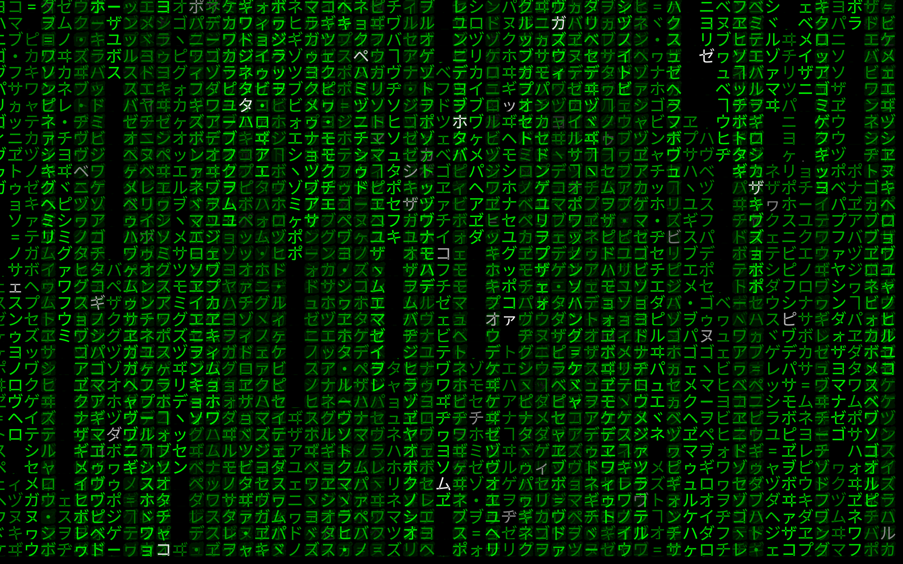
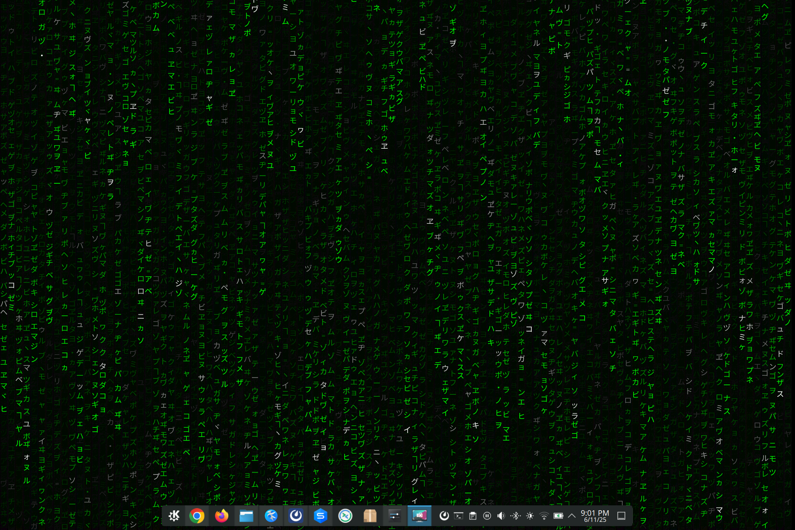

# Matrix-style Wallpaper for KDE Plasma 6

[](LICENSE)
[](LICENSE)

Provides a Matrix-esque "code rainfall" background wallpaper for Plasma 6, with some fun custommizations.

This is a fork of [obsidianreq/matrixrain-plasma6](https://github.com/obsidianreq/matrixrain-plasma6)
that cuts the wallpaper's CPU and GPU cost. See [Changes in this fork](#changes-in-this-fork).



## Changes in this fork

An animated wallpaper runs inside `plasmashell` all the time, so whatever it
costs is paid continuously, even when you can't see it. On a MacBook Pro 11,3
(Haswell i7 + GeForce GT 750M on nouveau) the original version kept a
`plasmashell` canvas thread, the Qt render thread and the compositor busy
around the clock. That load also ran into a separate post-suspend bug that left
the CPU stuck at 800 MHz, which made it look like several `plasmashell` processes
were pinned at 100%. Two changes fix the wallpaper's share of that.

### Glow removed

The glow was a `MultiEffect` shadow/blur pass layered over the whole screen.
To make it work, the Canvas was hidden and rendered *through* the effect, so
every frame went through an extra full-screen GPU pass even when glow was set
to 0. On a HiDPI panel that's a lot of pixels to blur several times a second,
and the glow is barely visible at normal settings. The effect, the `Glow`
setting and its config key are gone, and the Canvas now draws straight to the
screen.

The screenshot at the top is this fork, with no glow. For comparison, here's the
original project's screenshot:



### Animation pauses while the desktop is covered

The original paint timer always ran (`running: true`), redrawing the whole
canvas even when a maximized window completely hid the wallpaper. The wallpaper
now watches the window list (`TaskManager.TasksModel`, filtered to its own
screen, the current virtual desktop and the current activity, ignoring
minimized windows). While any maximized or fullscreen window is there, the
timer stops. The last frame stays on screen and the rain picks up again as
soon as the desktop is uncovered.

Measured on the machine above, the wallpaper's canvas thread went from about
820 ms of CPU per 10 s when visible to **0 ms** when covered. Windows that are
large but not maximized don't pause it.

## GPU driver: use nouveau, never NVIDIA's driver on Kepler

This fork was developed and tested on a MacBook Pro 11,3, whose GeForce GT 750M
is a **Kepler** GPU. If you have a Kepler NVIDIA GPU, **use the open-source
nouveau driver and do not install NVIDIA's proprietary driver.**

The only NVIDIA driver that still supports Kepler is the end-of-life
470xx legacy branch, and on this hardware it's unworkable:

- The test machine has always run nouveau, and this wallpaper runs smoothly on it
  under Plasma 6 (Wayland) with kernel 7.3.
- An identical MacBook Pro that ran the NVIDIA 470xx legacy driver became
  unusable: KWin compositor corruption, plus other major problems.

That matters especially for an animated wallpaper. It's drawn by `plasmashell`
and composited by KWin every frame, so a broken compositor shows up right on
your desktop. nouveau is in the mainline kernel and keeps working across kernel
upgrades. If you're coming from the NVIDIA driver, remove it completely,
including its packages and any `nouveau` blacklist in `/etc/modprobe.d/` or on
the kernel command line.

## Features

- Change font size
- Choose between single color, or multi-color with pre-defined palettes
- Customize drop speed
- Jitter effect
- Glitch chance for a random bright white characters
- Pauses automatically while a maximized or fullscreen window covers it

## Installation

installation requires `kpackagetool6` which can be found on the `kpackage`
package on arch based distros, `kpackagetool6` on Suse based distros, and
`kf6-kpackage` on debian based distros.

```bash
git clone https://github.com/doug445/matrixrain-plasma6.git
cd matrixrain-plasma6
./install.sh
kquitapp6 plasmashell && kstart plasmashell
```

`install.sh` installs the package, or upgrades it if an earlier version is
already installed. Then open system settings and there will be a new option
under wallpapers.

## Reporting Bugs

if you encounter any issues with the plugin, you can report them on
[this fork's issue tracker](https://github.com/doug445/matrixrain-plasma6/issues)
using the following steps:

- open a terminal and start journalctl with
  `journalctl -f | grep -i --line-buffered matrixrain` this will show logs
  related to the plugin.
- reproduce the issue.
- copy the logs from the terminal and paste them in the issue description.
- describe the issue in detail, and if possible provide steps to reproduce the
  issue.

if the issue cannot be reproduced, you may still open an issue with a
description of the issue and any relevant logs using
`journalctl -b -0 | grep -i matrixrain`, this will show logs related to the
plugin from the current boot.
